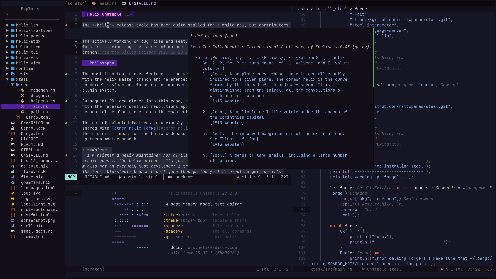

<div align="center">

<h1>
<picture>
  <source media="(prefers-color-scheme: dark)" srcset="logo_dark.svg">
  <source media="(prefers-color-scheme: light)" srcset="logo_light.svg">
  
</picture>
</h1>

[](https://github.com/helix-editor/helix/actions)
[](https://github.com/gravures/helix/releases/latest)
[](https://docs.helix-editor.com/)
[](https://github.com/helix-editor/helix/graphs/contributors)
[](https://matrix.to/#/#helix-community:matrix.org)

</div>



The [**helix**](https://github.com/helix-editor/helix) release cycle has been quite stalled for a while now, but contributors are actively working on bug fixes and feature implementation. The intent of this fork is to bring together a set of mature pull requests against the **helix** master branch.

## Philosophy

The most important merged feature is the *steel plugin system*; it is kept in sync with the helix master branch and referenced as *steel-master*. This allows building on *steel-master* and focusing on improvements and fixes not achievable through the plugin system.

Subsequent PRs are cloned into this repo, rebased onto the *steel-master* branch, with the necessary conflict resolutions applied. The final integration is done with sequential regular merges onto the *unstable-steel* branch.

The set of selected features is obviously opinionated, but many of these choices are shared with [other helix forks](#other-helix-forks). Features are also picked for their minimal impact on the helix codebase to ease future syncs with the helix upstream master branch.

> **Note**:
> I'm neither a helix maintainer nor affiliated in any way with the helix team; all credit goes to the helix authors. I'm just a user trying to keep my editor alive. I'm also not an everyday Rust developer; I try my best to make minimal and safe edits. The *unstable-steel* branch hasn't gone through the full CI pipeline yet, so it's currently in a "works on my machine" state. This could be fixed in future updates.
  
> **Note**: The [*welcome screen*](#welcome-screen) stands in for the current unstable version, but `helix --version` still reports the upstream version.

## Installation

There are no prebuilt releases available from this repo; **helix** should be built from sources. Ensure you have the [Rust toolchain](https://www.rust-lang.org/tools/install) installed.

Quick install:

```sh
export PREFIX=~/.local
export HELIX_DEFAULT_RUNTIME=$PREFIX/lib/helix/runtime
cargo install --git https://github.com/gravures/helix helix-term --root $PREFIX --locked
```

This will build and install **helix** with the *steel plugin system* into your chosen prefix.
For detailed build instructions, see [Building from source](book/src/building-from-source).

## Roadmap

### Merged

- [x] Steel plugin system: [PR#8675](https://github.com/helix-editor/helix/pull/8675)
- [x] features/treesitter-python-injection
- [x] features/language-mdx
- [x] Welcome screen: [PR#15173](https://github.com/helix-editor/helix/pull/15173)
- [x] Breadcrumb navigation bar: [PR#15573](https://github.com/helix-editor/helix/pull/15573)
- [x] Clickable buffer line: [PR#12173](https://github.com/helix-editor/helix/pull/12173)
- [x] vertical-buffer: [PR#13430](https://github.com/helix-editor/helix/pull/13430)
- [x] Resizable windows/focus mode: [PR#8546](https://github.com/helix-editor/helix/pull/8546)
- [x] basics-icons: [PR#12369](https://github.com/helix-editor/helix/pull/12369)
- [x] Render soft-wrap indicators in the gutter: [PR#14825](https://github.com/helix-editor/helix/pull/14825)
- [x] Scrollable file preview: [PR#15854](https://github.com/helix-editor/helix/pull/15854)
- [x] DAP: fix issue with debugpy corrupting terminal: [PR#15593](https://github.com/helix-editor/helix/pull/15593)
- [x] features/franky-theme
- [x] set-option commands in keybinding sequences: [PR#15860](https://github.com/helix-editor/helix/pull/15860)

### Survey

- [ ] Multi-character auto-pairs support: [PR#15105](https://github.com/helix-editor/helix/pull/15105)
- [ ] Match in next and previous char pairs: [PR#11695](https://github.com/helix-editor/helix/pull/11695)
- [ ] Code folding: [PR#14593](https://github.com/helix-editor/helix/pull/14593)
  * Lots of files touched → lots of conflicts
- [ ] Move selected lines up and down: [PR#14121](https://github.com/helix-editor/helix/pull/14121)
  * PR is stalled, with unresolved issues when multiple cursors are used
  * Adds two static commands already defined: move_line_up, move_line_down
  * This could be implemented as a *steel* plugin
- [ ] Inline Git Blame: [PR#13133](https://github.com/helix-editor/helix/pull/13133)
  * This could be implemented as a [*steel* plugin](#a-steel-git-blame)

## Feature Details

### Steel Plugin System

To use the new plugin system you will also need the **Steel** *interpreter* and *dylib* to run plugins, **forge** (the Steel package manager) to install plugins, and the **Steel language server** for editing Steel files.

```sh
cargo install --git https://github.com/mattwparas/steel.git steel-interpreter \
  steel-language-server cargo-steel-lib --root $PREFIX --locked --force
cargo install --git https://github.com/mattwparas/steel.git steel-forge \
  --root $PREFIX --locked --force
forge pkg refresh
```

Now you are ready to follow the getting-started guide in [Setting up configurations for helix](STEEL.md#setting-up-configurations-for-helix) and experiment with your setup.

#### Steel File Editing

> Note: It is better to configure the *steel-language-server* in your `languages.toml` file. This way, if you mess up your `init.scm` file (yes, you will ...), after a config reload the language server will still run.

These settings should go into your `~/.config/helix/languages.toml`:

```toml
[language-server.steel]
command = "steel-language-server"

[[language]]
name = "scheme"
language-servers = [ "steel" ]
formatter = { command = "schemat" }
auto-format = true
```

The Scheme language is already defined by default in **helix**, but with no language server and formatter set. You could install the [schemat](https://github.com/raviqqe/schemat) *Rust*-based Scheme formatter with:

```bash
cargo install schemat
```

#### Useful links

- [The Steel Handbook](https://mattwparas.github.io/steel/book/)
- [The Steel language documentation](steel-docs.md)
- [Matthew Paras's helix steel libraries](https://github.com/mattwparas/helix-config)
- [awesome helix](https://github.com/npupko/awesome-helix#plugins)
- [helix editor plugins](https://helixplugins.xyz/)

#### A Steel Git-Blame

A *steel* example of a **git-blame** feature: this exports two new commands, *git-blame* and *git-blame-hint*. Keybindings are also set at the end of this example. Press `# + b` to get the *blame* into the statusline, or `# + B` to get it displayed as an inlay hint.

```scheme
;; init.scm
(require "helix/editor.scm")
(require "steel/result")
(require "helix/configuration.scm")
(require (prefix-in helix. "helix/commands.scm"))
(require (prefix-in helix.static. "helix/static.scm"))
(require (only-in "helix/misc.scm" add-inlay-hint remove-inlay-hint-by-id))
(require-builtin helix/core/text)

(provide git-blame git-blame-hint)

(define (%current-path)
  (let* ([focus (editor-focus)]
         [focus-doc-id (editor->doc-id focus)])
    (editor-document->path focus-doc-id)))

;; Compact "sha author date" from one `git blame --date=short` line.
;; assumes author name has no ")" in it.
(define (%blame->hint s)
  (let* ([inside (car (split-once (cadr (split-once s "(")) ")"))]
         [tokens (reverse (cdr (reverse (split-whitespace inside))))] ; drop trailing line no
         [sha (car (split-whitespace s))]
         [short-sha (if (starts-with? sha "^")
                     (substring sha 1 (min (string-length sha) 8))
                     (substring sha 0 (min (string-length sha) 7)))])
    (string-append short-sha " " (string-join tokens " "))))

;; Returns: Option<String> raw git blame line | None
(define (%git-blame-line line)
  (let ([range (string-append (number->string line) "," (number->string line))])
    (let ([out (unwrap-or
                (ok-and-then
                  (spawn-process
                    (~> (command "git" (list "blame" "-L" range (%current-path)))
                      with-stdout-piped
                      with-stderr-piped)) ; capture stderr to avoid UI corruption
                  wait->stdout)
                "")])
      ; wait->stdout returns (Ok "") even when git fails
      ; — exit code is never surfaced, so empty = None
      (if (equal? out "")
        (None)
        (Some out)))))

;;@doc
;; Blame the current line
(define (git-blame)
  (let* ([line (helix.static.get-current-line-number)] ; 0 based
         [res (%git-blame-line (+ 1 line))])
    (if (Some? res)
      (helix.echo (%blame->hint (Some->value res)))
      (begin)))) ; no-op

;; Last hint snapshot id returned by add-inlay-hint, so a re-blame clears the old one.
(define %last-blame-hint-id (box #f))

;; Required for git-blame-hint: helix resets *all* inlay hints (including plugin
;; ones added via add-inlay-hint) on refresh when this is off.
(lsp (hash 'display-inlay-hints #t))

;;@doc
;; Blame the current line as inlay hint
(define (git-blame-hint)
  (let* ([line (helix.static.get-current-line-number)] ; 0 based
         [res (%git-blame-line (+ 1 line))])
    (if (Some? res)
      (let* ([rope (editor->text (editor->doc-id (editor-focus)))]
             ; inline hint renders *before* the char at this index,
             ; so point at the newline = end of the visible line.
             [char-index (- (rope-line->char rope (+ 1 line)) 1)])
        (when (unbox %last-blame-hint-id)
          (apply remove-inlay-hint-by-id (unbox %last-blame-hint-id)))
        (set-box! %last-blame-hint-id
          (add-inlay-hint char-index (string-append " "
                                      (%blame->hint (Some->value res))))))
      (begin)))) ; no-op

;;;;;;;;;;;;;;;;;;;;;;;;;;;;;;;;;;;;;;;;
;; Key Bindings
(require (only-in "helix/keymaps.scm" keymap))

(keymap (global)
  (normal ("#"
           ("b" ":git-blame")
           ("B" ":git-blame-hint"))))
```

### Treesitter Python Injection

Small feature of my own that adds *reStructuredText* syntax highlighting to Python docstrings.

### MDX Language Support

Adds *mdx* as a proper language definition with language servers set to ["mdx-language-server", "rumdl", "astro-ls"]. As a consequence, *mdx* has been removed from the markdown language file-types.
Also adds treesitter queries for *mdx*.

```bash
npm install -g @mdx-js/language-server
```

### Welcome Screen

When you launch helix with `hx`, you are greeted with a pleasant welcome screen.

```toml
[editor]
welcome-screen = false
```

### Breadcrumb Navigation

A toggleable breadcrumb bar that shows where you are in your code (the treesitter location).

```toml
[editor.breadcrumb]
enable = true
# full: helix-term > src > commands > typed.rs > TypeableCommand > name
# file: typed.rs > TypeableCommand > name
# none: TypeableCommand > name
path = "full|file|none"
```

### Clickable Buffer Line

Simply switch buffers by clicking on their names.

### Vertical Buffer

On narrow terminals, the picker and preview automatically stack vertically.

### Resizable Window Splits

**Window Resizing**:

- `Alt+w h` or `Alt+w left` - Shrink window width
- `Alt+w l` or `Alt+w right` - Grow window width  
- `Alt+w j` or `Alt+w down` - Shrink window height
- `Alt+w k` or `Alt+w up` - Grow window height

**Focus Mode**:

- `Alt+w f` - Toggle focus mode (expands current window)

**Sticky Mode**: activate sticky mode with `Alt+W` (Alt + Shift + w),
then use single keys for repeated resizing:

- `h` or `left` - Shrink width
- `l` or `right` - Grow width  
- `j` or `down` - Shrink height
- `k` or `up` - Grow height
- `f` - Toggle focus mode

Sticky mode stays active until you press a key that's not part of the window resize commands.

These *static commands* are added: *shrink_buffer_width*, *shrink_buffer_height*, *grow_buffer_width*, *grow_buffer_height*, and *toggle_focus_window*, so you can remap key bindings.

### Soft Wrap Indicators

These indicators are now displayed in the gutter.

### Icons Support

Icons are available across all pickers, the statusline, bufferline, and the completion list.

```toml
[icons.kind]
# show icons in autocompletion, symbols pickers
enable = true

[icons.fs]
# show icon in buffers-line and with status-line file-type and file-pickers
enable = true

[icons.vcs]
# visible in the changed-file picker
enable = true
branch = "⌬"

[icons.diagnostic]
warn = "▲"
```

> **Note on divergences from [PR#12369](https://github.com/helix-editor/helix/pull/12369):**
>
> - These config keys still work: `[editor.statusline] separator`, `[editor.whitespace] characters` (space, nbsp, nnbsp, tab, tabpad, newline) and `[editor.soft-wrap] wrap-indicator`. Existing configs need no migration.
> - At this time `wrap-indicator` is only handled through the legacy key, since the indicator is [displayed in the gutter](#soft-wrap-indicators).
> - Precedence when both are set: **user-set `[icons.*]` > non-default legacy key > icon default**
> - Steel keeps writing the legacy keys, so `set-option!` / `get-config-option-value` work as before for whitespace, statusline separator and wrap-indicator — but the new `[icons.*]` keys can only be set in `config.toml`, not from steel
> - The Steel engine is untouched, so PR descriptions of internals don't match this fork

### New Theme

Includes the new [franky theme](https://github.com/gravures/franky).

## Bug Fixes

### Multi Keybinding Sequences

Fixes [#13187](https://github.com/helix-editor/helix/issues/13187): you can now write this kind of keybinding:

```toml
[keys.normal]
space.x = [":toggle whitespace.render.newline all none", ":toggle whitespace.render.tab all none"]
```

## Debugpy DAP

Fixes issues [6265](https://github.com/helix-editor/helix/issues/6265) and [12722](https://github.com/helix-editor/helix/discussions/12722).

## Other Helix Forks

- [helix-unstable](https://github.com/Helix-Unstable/helix-unstable): the exact same philosophy, currently a different, smaller feature set, and no steel integration yet
- [gj1118 fork](https://github.com/gj1118/helix): similar philosophy, more features, with a *Lua*-based plugin system
- [mitos editor](https://github.com/mitos-editor/mitos): a real fork of helix, with its own set of features and no plugin system to my knowledge
